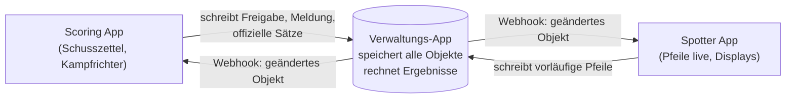

# BowFlow

Offene Schnittstellen-Definition, über die Apps bei Bogensport-Wettkämpfen Daten austauschen, zum Beispiel Liga App, Scoring App (digitaler Schusszettel) und Spotter App (Pfeilwerte live). Die Spezifikation beschreibt den technischen Ablauf und die Objekte, die zwischen den Apps ausgetauscht werden. Namen wie Bennu (Liga), SiaScore (Scoring) und Fawkes (Spotter) stehen nur als Beispiele.

Status: Entwurf 1.0. Arbeitstitel „BowFlow".

## Aufbau: Kern und Profile

Die Spezifikation besteht aus einem **Kern** und **Profilen**.

- Der **Kern** legt fest, *wie* Apps kommunizieren: Beitritt, Token, Webhooks, Snapshot, Konventionen. Er gilt für jede Wettkampfart.
- Ein **Profil** legt für eine Wettkampfart fest, *was* ausgetauscht wird: Objekte, Zugriffsarten, Abläufe, Begriffe.

Gestartet wird mit der Liga, weil es dort schon umfangreiche Software gibt, die miteinander kommunizieren soll. Weitere Wettkampfarten wie Meisterschaften kommen als eigene Profile dazu. Eine App kann mehrere Wettkämpfe verschiedener Profile bedienen, zum Beispiel eine Scoring App, die einmal einen Ligawettkampf und einmal eine Meisterschaft erfasst.

| Profil | Wettkampfart | Status |
|---|---|---|
| [`league`](profiles/league/README.md) | Liga-Wettkämpfe | Entwurf |
| `championship` | Meisterschaften | geplant |

## Kernidee

1. Bei jedem Wettkampf gibt es eine **Verwaltungs-App** (im Profil `league`: die Liga App) und beliebig viele **verbundene Apps**.
2. Die Apps reden **nie direkt miteinander**, sondern nur mit der Verwaltungs-App. Sie speichert alle geteilten Objekte.
3. Eine verbundene App tritt mit einem 6-stelligen Code bei und bekommt ein Token für den Wettkampf.
4. Pro Objekt ist festgelegt, ob verbundene Apps es nur **lesen** oder auch **schreiben** dürfen. Es gilt der letzte Schreibzugriff.
5. Ändert sich ein Objekt, schickt die Verwaltungs-App es per **Webhook** an alle anderen Apps. Ein Abruf des gesamten Stands (Snapshot) dient als Fallback.
6. Nur die Verwaltungs-App rechnet. Verbundene Apps erfassen und zeigen an.



## Inhalt

| Ordner / Datei | Inhalt |
|---|---|
| [core/docs/](core/docs/01-konzept.md) | Kern: [Konzept](core/docs/01-konzept.md), [Beitritt](core/docs/02-beitritt.md), [Benachrichtigungen](core/docs/03-benachrichtigungen.md), [Konventionen](core/docs/04-konventionen.md), [Profile](core/docs/05-profile.md), [Entscheidungen](core/docs/06-entscheidungen.md) |
| [core/schemas/](core/schemas/), [core/api/openapi.yaml](core/api/openapi.yaml), [core/examples/](core/examples/) | Kern: Schemas, OpenAPI (Beitritt und Webhook), Beispiele |
| [profiles/league/](profiles/league/README.md) | Profil Liga: Objekte, Abläufe, Glossar, Schemas, OpenAPI, Beispiele |
| [GOVERNANCE.md](GOVERNANCE.md) | Wie sich die Spezifikation weiterentwickelt |
| [tools/validate.py](tools/validate.py) | Prüft Schemas, Beispiele, OpenAPI, Profile und Links |

Empfohlene Lesereihenfolge: Kern-Konzept, Profil-Konzept, Wettkampftag, Objekte, Rest bei Bedarf.

## Prüfen

```bash
python tools/validate.py
```

Abhängigkeiten: `jsonschema`, `pyyaml`, `openapi-spec-validator`.

## Lizenz

MIT, siehe [LICENSE](LICENSE). Gilt für Spezifikation, Schemas, Beispiele und Werkzeuge.
