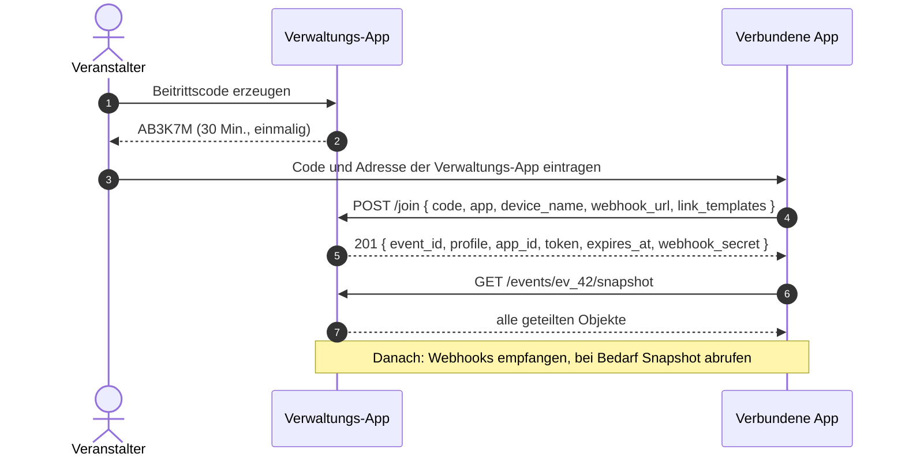

# Kern 2 · Beitritt und Absicherung

## Ablauf



Die Antwort nennt das **Profil** des Wettkampfs, zum Beispiel `league`. Es legt fest, welche Objekte es gibt. Unterstützt die App das Profil nicht, bricht sie ab.

## Der Code

- 6 Zeichen, 30 Minuten gültig, nur einmal benutzbar.
- Zeichensatz: `ABCDEFGHJKLMNPQRSTUVWXYZ23456789`, also ohne leicht verwechselbare Zeichen (`0`, `O`, `1`, `I`). Groß- und Kleinschreibung ist egal.
- Er gehört zu genau einem Wettkampf (`event`).
- Ungültig, abgelaufen oder benutzt: `401` mit `JOIN_CODE_INVALID`. Das zählt als Fehlversuch.
- Zu viele Fehlversuche (zum Beispiel von derselben Adresse): `429` mit `RATE_LIMITED`. Die Schwelle legt die Verwaltungs-App fest; sie sollte hoch genug sein, weil bei Wettkämpfen viele legitime Geräte hinter derselben Adresse sitzen.

## Token

- Die Verwaltungs-App gibt der App ein **Token**. Es gilt bis `expires_at` aus der Antwort, mindestens bis zum Ende des Wettkampfs. Üblich ist das Ende des Folgetags.
- Die App kann beim Beitritt einen `device_name` mitgeben (zum Beispiel „Tablet Halle"), den die Verwaltungs-App in ihrer Verbindungsliste zeigt.
- Die App sendet es bei jedem Aufruf als `Authorization: Bearer <token>`.
- Ein Widerruf ist nicht Teil der Spezifikation. Das macht die Verwaltungs-App selbst.

## Webhook-Signatur

- Zusammen mit dem Token bekommt die App ein `webhook_secret`.
- Die Verwaltungs-App signiert jeden Webhook: Header `X-Interop-Signature: sha256=<HMAC-SHA256 des Bodys mit dem webhook_secret, hexadezimal>`.
- Die App prüft die Signatur und verwirft Webhooks ohne gültige Signatur.

## Link-Vorlagen

Beim Beitritt kann die App `link_templates` mitgeben: Vorlagen für Links mit Platzhaltern in geschweiften Klammern. Die Verwaltungs-App setzt die Platzhalter ein und nutzt die Links, zum Beispiel für einen QR-Code auf einem Formular.

```json
{ "scoresheet": "https://scoring.example.org/score/9f2c1d7e-0a5b-4c3e-8d2f-6b1a7c9e4f10/{scoresheet_id}" }
```

Welche Schlüssel und Platzhalter es gibt, legt das [Profil](05-profile.md) fest. Das Token im Link ist Sache der App und für den Wettkampf immer gleich.
