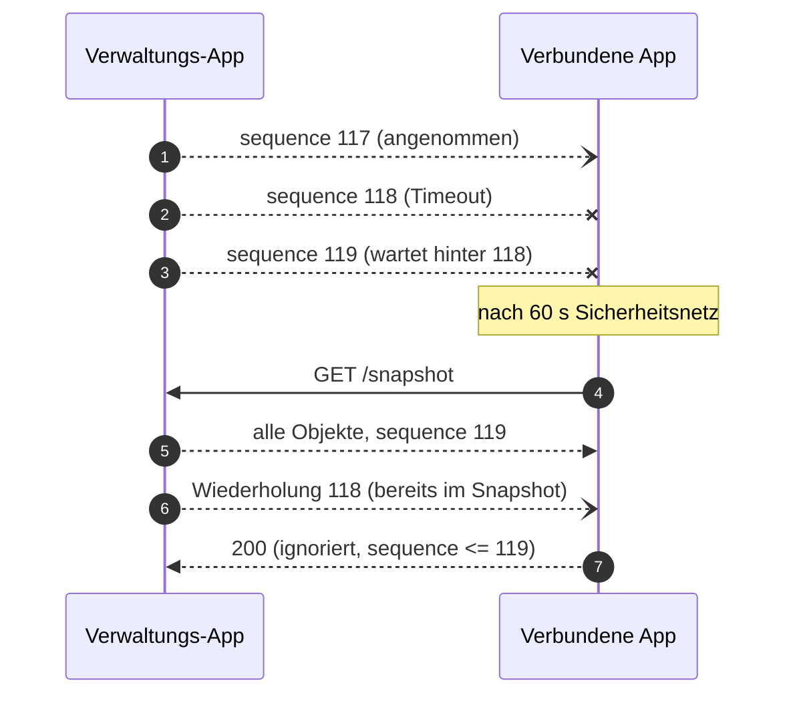

# Kern 3 · Benachrichtigungen (Webhooks) und Fallback

## Prinzip

1. Eine verbundene App schreibt ein Objekt an die Verwaltungs-App (`PUT`).
2. Die Verwaltungs-App speichert es und schickt es per Webhook an **alle anderen** verbundenen Apps. Nicht an die App, die geschrieben hat.
3. Der Empfänger ersetzt seinen Stand durch das Objekt aus dem Webhook.
4. Apps ignorieren Typen, die sie nicht brauchen.

Ändert die Verwaltungs-App selbst etwas (berechnete Ergebnisse, Korrekturen), geht der Webhook an alle verbundenen Apps.

**Regel gegen Schleifen:** Eine App schreibt einen empfangenen Stand nie zurück. Sie sendet nur, wenn ein Mensch oder ihre eigene Logik etwas ändert.

## Aufbau

```json
{
  "sequence": 118,
  "sent_at": "2026-11-29T10:14:07+01:00",
  "event_id": "ev_42",
  "type": "official_set.updated",
  "object": { "scoresheet_id": "ss_101", "set_number": 2, "...": "..." }
}
```

- `type`: `<objekt>.updated` oder `<objekt>.deleted`. Die erlaubten Typen legt das [Profil](05-profile.md) fest.
- `sequence`: fortlaufend **je Empfänger**, beginnt bei 1. Wiederholungen derselben Benachrichtigung tragen dieselbe Nummer.
- `object`: das vollständige geänderte Objekt. Bei `*.deleted` nur die Schlüsselfelder.
- Header `X-BowFlow-Signature`, siehe [Beitritt](02-beitritt.md).

## Zustellung

- Die App antwortet mit `2xx`. Alles andere zählt als Fehler.
- Die Verwaltungs-App wiederholt nach 5 s, 30 s, 2 min, 10 min, 30 min und 1 h.
- Die Reihenfolge je Empfänger bleibt erhalten: Eine neue Benachrichtigung wartet hinter einer fehlgeschlagenen.
- Doppelte Zustellung ist möglich. Empfänger erkennen sie an der `sequence` (bereits gesehen) und ignorieren sie.

## Fallback: Snapshot

`GET /events/{event_id}/snapshot` liefert alle geteilten Objekte des Wettkampfs auf einmal plus die aktuelle `sequence`. Das Schema des Snapshots legt das Profil fest. Eine App ruft ihn ab,

1. beim Start,
2. nach jedem Verbindungsabriss,
3. wenn sie eine Lücke in der `sequence` bemerkt,
4. als Sicherheitsnetz **alle 60 Sekunden**.

Sie ersetzt danach ihren gesamten Stand und setzt ihre erwartete Laufnummer auf `sequence + 1`.


