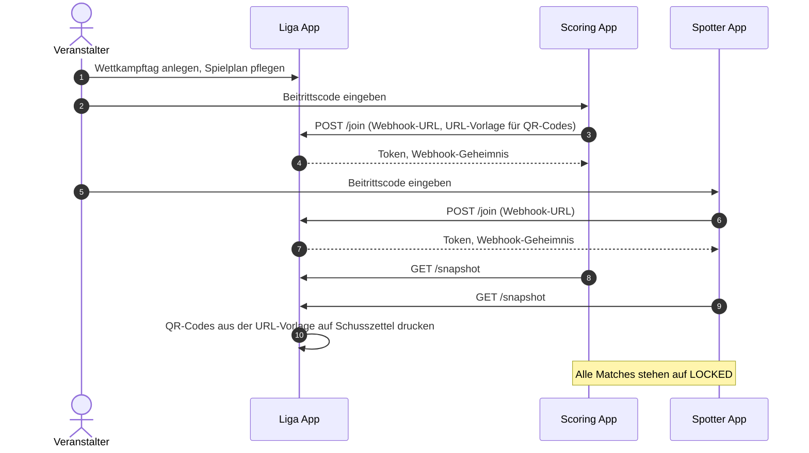
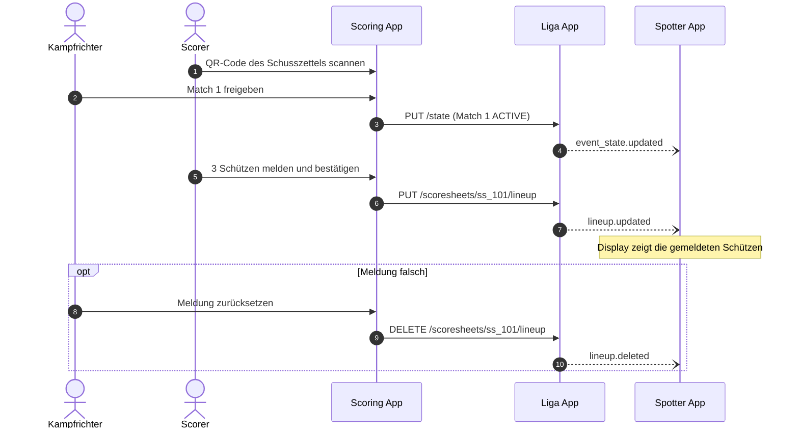
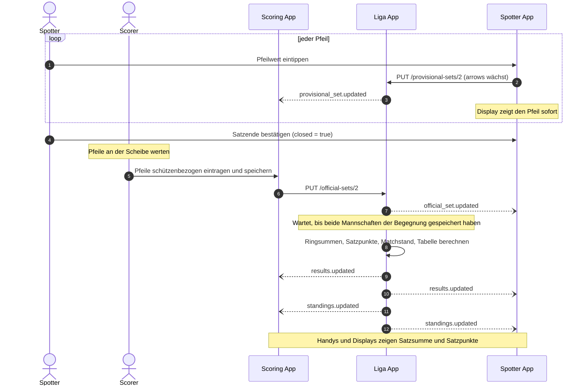
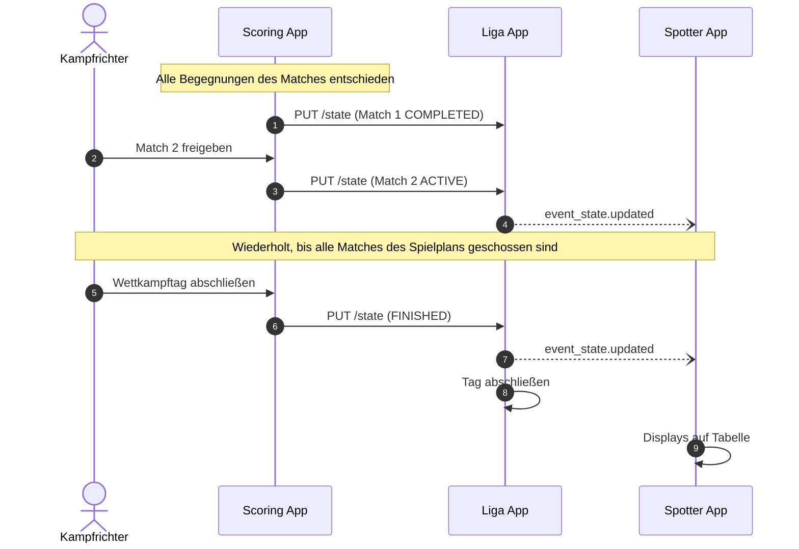
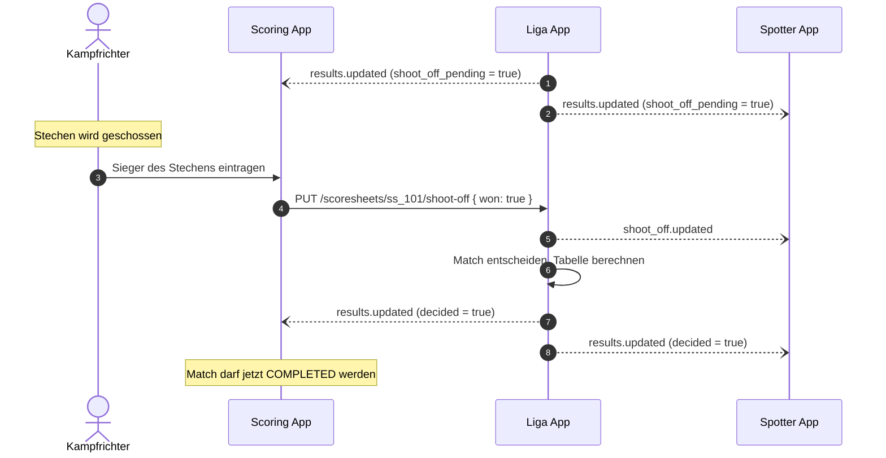
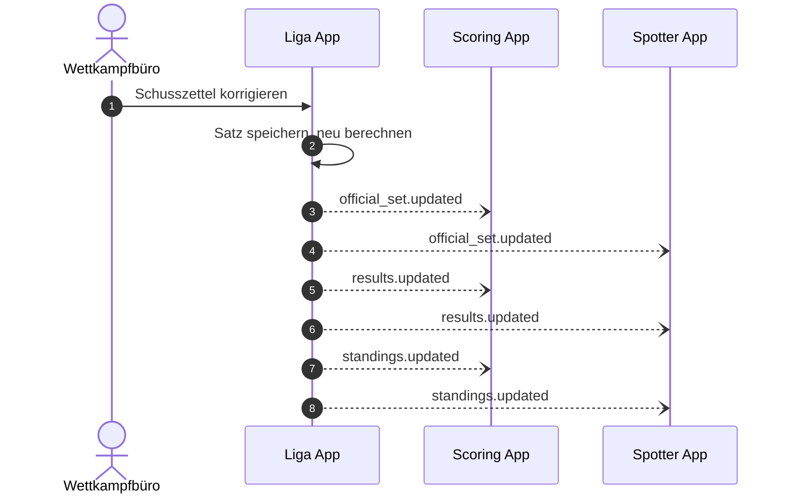

# 5 · Ablauf eines Wettkampftags

Beispiel mit Liga App (L), Scoring App (S) und Spotter App (P). Jeder Pfeil zwischen Apps läuft über die Liga.

## Vorbereitung

## Freigabe und Meldung

## Ein Satz

Strafpunkte trägt der Kampfrichter in der Scoring App ein. Sie gehen als `penalty_points` mit dem offiziellen Satz an die Liga.

## Nächstes Match und Tagesende

## Stechen (nur Modus `KNOCKOUT`)

Im Modus `LEAGUE` entfällt das Stechen: Bei 5:5 nach allen Sätzen ist das Match unentschieden und sofort entschieden.

## Korrektur

Eine App, die keine Webhooks bekommt, sieht die Korrektur spätestens beim nächsten Snapshot.
